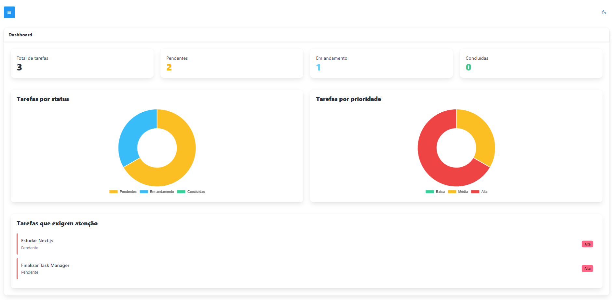
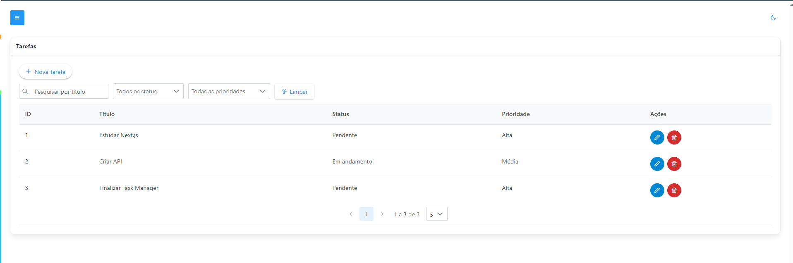
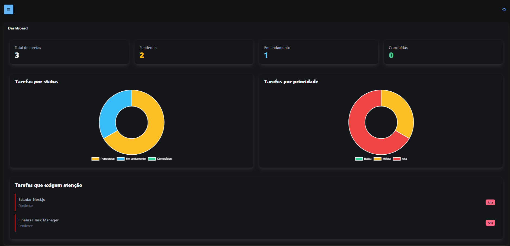

# ✅ Task Manager

Aplicação **Full Stack para gerenciamento de tarefas**, desenvolvida com **Next.js, React, TypeScript e PrimeReact**, integrada a uma **ASP.NET Core Web API**.

O projeto foi desenvolvido com foco em organização de código, experiência do usuário, responsividade e integração entre frontend e backend.

---

## 📸 Preview

> Screenshots da aplicação serão adicionados nesta seção.

### Dashboard



### Gerenciamento de tarefas



### Dark Mode



---

## 🚀 Funcionalidades

### 📊 Dashboard

- Indicadores resumidos das tarefas
- Distribuição de tarefas por status
- Distribuição de tarefas por prioridade
- Gráficos para acompanhamento das tarefas
- Resumo geral das atividades

### ✅ Gerenciamento de tarefas

- Cadastro de novas tarefas
- Edição de tarefas existentes
- Exclusão com confirmação
- Listagem das tarefas
- Pesquisa de tarefas por título
- Filtros
- Paginação

### 🎨 Interface

- Layout responsivo
- Tema claro e escuro
- Sidebar de navegação
- Feedback visual com Toast
- Indicadores de carregamento
- Validação de formulários
- Componentes reutilizáveis

---

## 🛠️ Tecnologias utilizadas

### Frontend

- Next.js
- React
- TypeScript
- PrimeReact
- PrimeFlex
- Axios
- Chart.js

### Backend

O frontend consome uma API REST desenvolvida utilizando:

- ASP.NET Core Web API
- C#
- Swagger / OpenAPI

Repositório do backend:

[Task Manager API](https://github.com/leaodiego/task-manager-api)

---

## 🏗️ Arquitetura

O projeto utiliza uma arquitetura separando frontend e backend.

```text
┌──────────────────────────────┐
│     task-manager-nextjs      │
│                              │
│ Next.js + React              │
│ TypeScript + PrimeReact      │
│ Chart.js                     │
└──────────────┬───────────────┘
               │
               │ HTTP / REST
               ▼
┌──────────────────────────────┐
│       task-manager-api       │
│                              │
│ ASP.NET Core Web API         │
│ C# + Swagger                 │
└──────────────────────────────┘
```

Durante o desenvolvimento local:

```text
Frontend
http://localhost:3000

        │
        │ REST
        ▼

Backend
http://localhost:5161
```

---

## 📁 Estrutura do projeto

```text
task-manager-nextjs/
│
├── public/
│   └── themes/
│
├── src/
│   ├── components/
│   │   ├── common/
│   │   ├── dashboard/
│   │   └── tarefas/
│   │
│   ├── enums/
│   ├── hooks/
│   ├── models/
│   ├── pages/
│   ├── services/
│   └── styles/
│
├── .env.example
├── .gitignore
├── next.config.ts
├── package.json
├── tsconfig.json
└── README.md
```

---

## ⚙️ Configuração do ambiente

### Pré-requisitos

Para executar o frontend localmente, é necessário ter instalado:

- Node.js
- npm
- Git

Também é necessário executar a API do Task Manager para que o frontend possa carregar e manipular os dados.

Backend:

[Task Manager API](https://github.com/leaodiego/task-manager-api)

---

## 📥 Clonando o frontend

```bash
git clone https://github.com/leaodiego/task-manager-nextjs.git
```

Entre no diretório:

```bash
cd task-manager-nextjs
```

Instale as dependências:

```bash
npm install
```

---

## 🔐 Variáveis de ambiente

Crie o arquivo:

```text
.env.local
```

na raiz do projeto.

Utilize o `.env.example` como referência:

```env
NEXT_PUBLIC_API_URL=http://localhost:5161
```

A variável:

```text
NEXT_PUBLIC_API_URL
```

define a URL utilizada pelo frontend para comunicação com a API.

> O arquivo `.env.local` representa a configuração local do ambiente e não deve ser versionado.

---

## ▶️ Executando o backend

Clone o repositório da API:

```bash
git clone https://github.com/leaodiego/task-manager-api.git
```

Entre no projeto:

```bash
cd task-manager-api
```

Restaure as dependências:

```bash
dotnet restore
```

Execute:

```bash
dotnet run
```

No ambiente atual de desenvolvimento, a API utiliza:

```text
http://localhost:5161
```

A documentação Swagger pode ser acessada localmente em:

```text
http://localhost:5161/swagger
```

---

## ▶️ Executando o frontend

Com a API em execução, abra outro terminal dentro do projeto frontend:

```bash
npm run dev
```

Acesse a aplicação pelo endereço apresentado pelo Next.js no terminal.

No ambiente local utilizado no projeto, frontend e backend se comunicam desta forma:

```text
Next.js
localhost:3000
      │
      │ HTTP / REST
      ▼
ASP.NET Core API
localhost:5161
```

---

## 🔄 Integração com a API

A comunicação com o backend está centralizada na camada:

```text
src/services/
```

A URL base da API é obtida através de:

```ts
process.env.NEXT_PUBLIC_API_URL
```

Isso permite configurar o endereço da API de acordo com cada ambiente sem manter a URL diretamente no serviço.

As operações do gerenciamento de tarefas utilizam os endpoints disponibilizados pelo backend.

```text
GET     /api/Tarefas
POST    /api/Tarefas
GET     /api/Tarefas/{id}
PUT     /api/Tarefas/{id}
DELETE  /api/Tarefas/{id}
```

---

## 🧪 Validação do projeto

### ESLint

```bash
npm run lint
```

### Build de produção

```bash
npm run build
```

---

## 🔗 Repositórios

### Frontend

[task-manager-nextjs](https://github.com/leaodiego/task-manager-nextjs)

### Backend

[task-manager-api](https://github.com/leaodiego/task-manager-api)

---

## 🎯 Objetivos do projeto

O Task Manager foi desenvolvido para aplicar e demonstrar conhecimentos em:

- Desenvolvimento Full Stack
- Next.js
- React
- TypeScript
- ASP.NET Core Web API
- C#
- Construção e consumo de APIs REST
- CRUD
- Integração frontend/backend
- Componentização
- Responsividade
- Tema claro e escuro
- Dashboard e visualização de dados
- Variáveis de ambiente
- Swagger / OpenAPI
- Git e GitHub

---

## 👨‍💻 Autor

**Diego Viana Leão**

GitHub:

[leaodiego](https://github.com/leaodiego)

---

## 📄 Status

🚧 Projeto em evolução.

O frontend e o backend estão funcionais e integrados. Novas funcionalidades, melhorias visuais e opções de deploy poderão ser adicionadas conforme a evolução do projeto.
